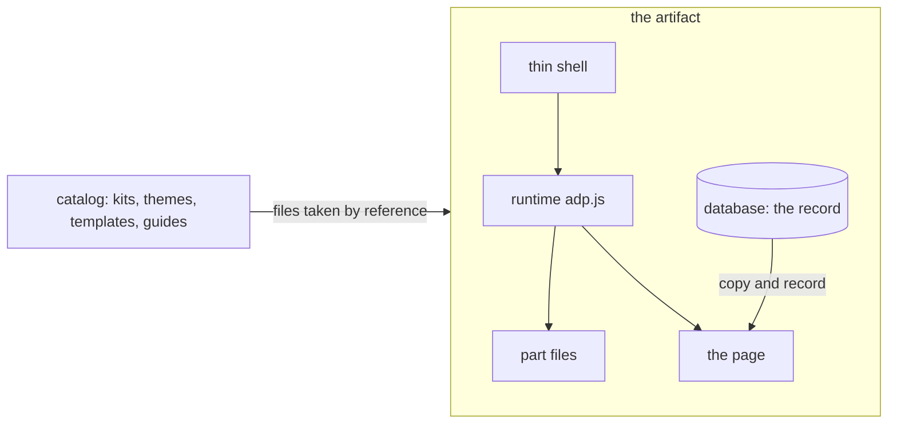
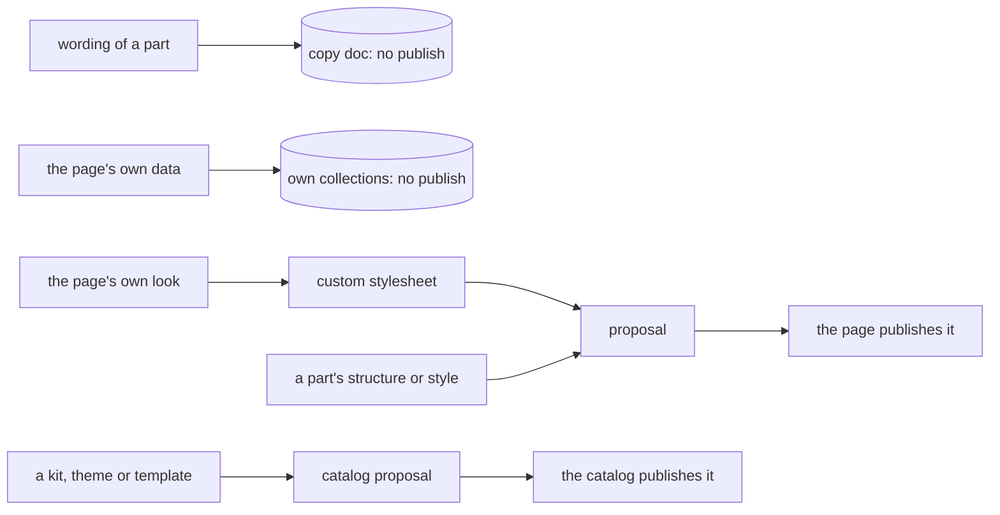
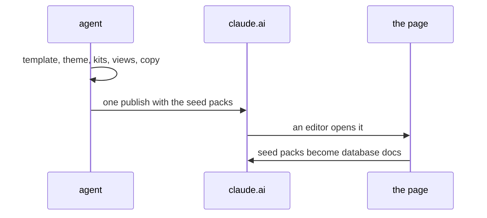
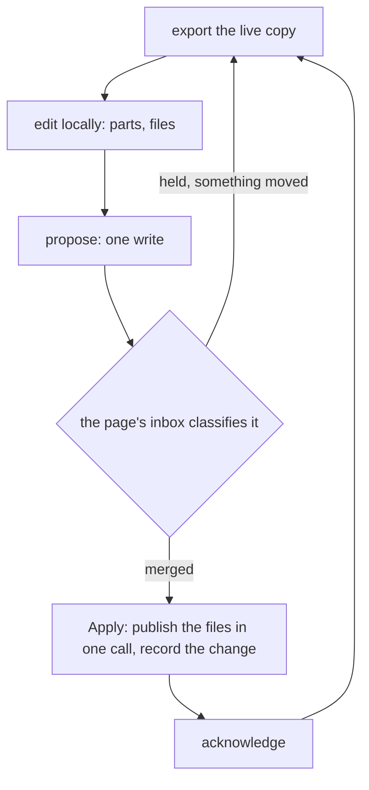
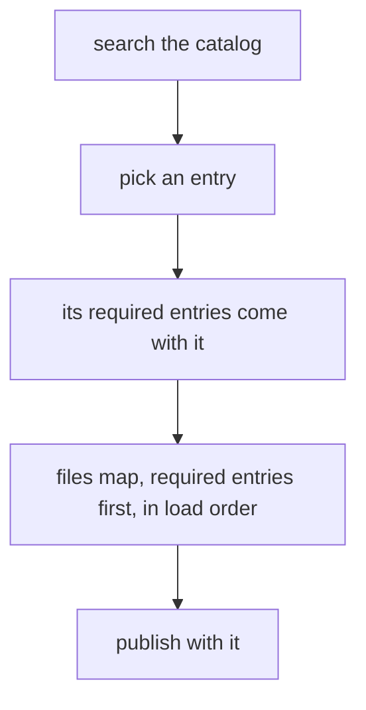
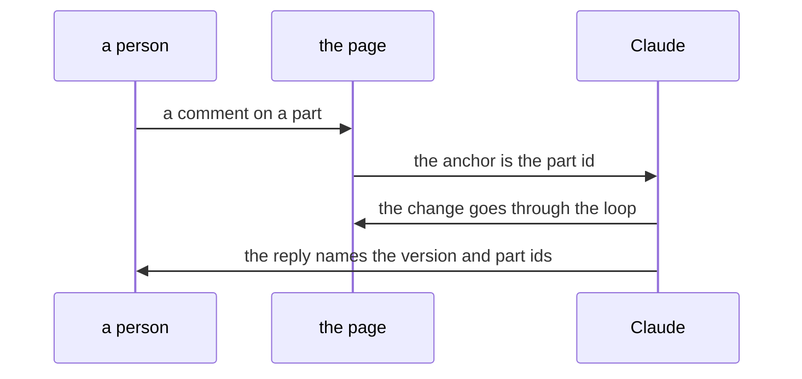

<!--
ADP: how it works
The quickstart a model reads first, mostly Mermaid diagrams and no code: the pieces of an ADP artifact, where each change goes, the first publish, the edit loop the page's inbox applies, building from the catalog, comments, and where the detail lives.

Provides (no global): the quickstart.

@id        guide.artifact-dataplane
@kind      guide
@group     Guides
@status    stable
@version   0.2.0
@updated   2026-11-24
@summary   The quickstart a model reads first: what ADP is, in diagrams, and where to go for each job.
@tags      adp, protocol, guide, quickstart, db, parts, adp/2
@requires  none
@files     none
@provides  none
@tokens    none
@globals   none
@db        none
@source    ADP | the artifact dataplane standard | rewritten as the quickstart a model reads first
@preview   {"render": "guide", "samples": ["kit/guides/artifact-dataplane.md"], "uses": ["kit.mermaid"]}
@changed   Rewritten as the quickstart a model reads first: what ADP is, in Mermaid diagrams and without code, the edit loop the page's inbox applies, where each job goes next, and the two repositories. The many-editors framing is gone; concurrency is one section.
-->

# ADP: how it works

ADP (Artifacts Done Properly) is a protocol and a framework for structured claude.ai Artifacts. The page is a thin shell. The record lives in the artifact's database, mapped to the page's regions, its **parts**. Changes are records, not republishes: an agent works on a local copy, sends the difference as one database write, and the page applies it. Pages are built from a catalog of kits, themes and templates, so nothing is rebuilt by hand.

Read this guide first. Each section is one idea and one diagram; the last section says where the precise detail lives.

## 1. The pieces

- **Shell.** A small `index.html` that loads the runtime and the part files.
- **Parts.** Every addressable piece of the page has a stable id, such as `triage.keys-table`, and a hash of its content. An id never changes once published.
- **Record.** The database holds the copy, the manifest of parts and hashes, every change, the owner's decisions and the open requests. The runtime paints the page from it.
- **Catalog.** A published artifact whose files are reusable entries. A page takes them by reference; the server copies the files.

## 2. Where each change goes

A kit is never edited inside a page: fix it in the catalog and take it again, so the next page gets the fix.

## 3. A new page: first publish and seeding

The agent never writes the first record by hand: the page seeds itself on its first open by an editor. A client set to open pages on publish does that at once.

## 4. Changing a page: the loop

- **Export** lays out the live files locally, beside the record they belong to.
- **Edit** keeps every part marker. A new piece gets its own part id; a retired id is never reused.
- **Propose** writes one proposal doc: the changed parts, and each changed file with the hash of the file it replaces.
- **The inbox** is the catalog's inbox pattern, and every template mounts it. When an editor opens the page, it classifies the proposal against the manifest as merged or held. Apply, pressed by an editor or automatic where the page turns that on, publishes the files in one call and records the change in What changed.
- **Held** means something moved since the export. The inbox names it; export again and propose again.

Propose stops and names what it cannot send: a part that changed live as well as locally since the export, and a deleted part given no reason.

## 5. Building from the catalog

- Take entries **by reference**: the files map names the catalog's files and the server copies them. Nothing is retyped or downloaded.
- Each entry is described by the header of its main file; the catalog's index is built from those headers.
- Every page wears a theme. All themes set the same token names, so a page can switch themes while it runs.

## 6. Comments and requests

Anchors are part ids, not positions on the screen, so a comment stays on its part when the layout changes. A request from the page's Claude pane is a database doc, and its answer is a write to that doc.

## 7. Concurrency

claude.ai provides the lock. Every database read returns a version, and a write to an existing doc carries it (`if_version`); a page-side publish carries the hash of each file it replaces (`ifMatch`). A refused write or a held proposal means someone wrote first: export again and continue from what is live. These pins are what let people and agents work on one page at the same time.

## 8. The record

| doc | holds |
|---|---|
| `manifest/current` | the layout version, the page hash, every part's hash, every file's hash |
| `parts/<id>` | a part's title, parent, hash and current holder |
| `content/<id>` | a part's copy |
| `changes/<seq>` | every change, append-only: who, when, the parts and docs it touched |
| `decisions/<slug>` | the owner's decisions, quoted |
| `threads/<id>`, `requests/<id>` | comment threads and requests, with their part and status |
| `incoming/<pid>` | proposals and their status: new, merged, held, applied, declined |
| `agents/<name>`, `presence/` | who works on the page, and who is watching it |
| `config/current`, `checks/latest` | the page's switches and its self-check |
| `ns/shared/`, `ns/users/{self}` | the page's own data, by the namespaces pattern: shared, and each viewer's own |

Part ids are lowercase kebab words joined by dots, view first: `home`, `triage.keys-table`.

## 9. Where to go next

The skills come with the two plugins in the repositories below, and they must be installed before any of this runs; the Home's start prompt offers that. With either plugin, start at the skill `adp`: it routes to the right one. In the catalog's plugin the routes are:

| the job | read |
|---|---|
| a new page, board, tracker or assistant | the skill `adp-new` |
| change a page, answer a comment or a request | the skill `adp-edit` |
| find, take or add a catalog entry | the skill `adp-catalog` |
| put an existing artifact on ADP | the skill `adp-adopt` |
| set ADP up, or anything else | the skill `adp`, which routes to the four above |

The skills carry the exact steps. The `adp.py` tool in the `adp` skill computes hashes and diffs and prints every Artifact and ArtifactData call, so nothing is typed by hand.

**Repositories**
- The protocol: https://github.com/fblgit/fblgit-claude-marketplace (the artifact-data-protocol plugin).
- The catalog, the skills and the tools: https://github.com/fblgit/artifacts-done-properly.
