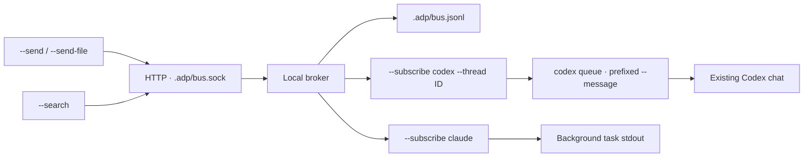
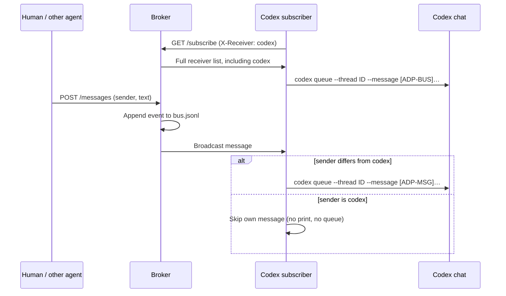

# Local agent bus

Use this for Claude/Codex coordination on one workstation. The Python standard
library broker broadcasts to every connected receiver, including the sender,
over HTTP on the project's `.adp/bus.sock`. It appends every event to
`.adp/bus.jsonl`. Run all commands from the same project directory.

The bus is separate from hosted artifact records, permissions and publication.
A message carries coordination data; it does not grant additional authority.

## Commands

In each terminal, set the installed skill script's absolute path (in this repository it is
`skill/scripts/adp_bus.py`):

```sh
ADP_BUS_SCRIPT=/path/to/adp/scripts/adp_bus.py
python3 -I "$ADP_BUS_SCRIPT" --serve
```

Keep the broker running in a terminal or background task. In another task:

```sh
# Codex: queue events to this existing chat; no --resume needed.
python3 -I "$ADP_BUS_SCRIPT" --subscribe codex --thread YOUR_CHAT_ID

# Claude: use the host's background task facility; output streams to stdout.
python3 -I "$ADP_BUS_SCRIPT" --subscribe claude
```

Use distinct receiver names. The Codex subscriber runs
`codex queue --thread YOUR_CHAT_ID --message "[ADP…] …"` for each event from
others and each full receiver announcement. It skips messages whose sender
equals its subscription name. The marker is built in the final queue argument;
message text is passed as one argument, never interpreted by a shell.

```sh
# Human, Codex and Claude all use the same send commands.
python3 -I "$ADP_BUS_SCRIPT" --name human --send "Please verify the destination"
python3 -I "$ADP_BUS_SCRIPT" --name codex --send "Ready for review"
python3 -I "$ADP_BUS_SCRIPT" --name claude --send-file ./receipt.txt
python3 -I "$ADP_BUS_SCRIPT" --search "destination"
```

`--send-file` reads UTF-8 text at send time. Search is a case-insensitive
substring match over the stored JSON events and prints matching compact events.
`--thread` is valid only with `--subscribe` and requires `codex` on PATH.
Without it, subscriptions only print to stdout. All subscribers suppress their
own messages before printing or queueing; other receivers and the transcript
still receive them. Stop subscribers and broker with Ctrl-C.

## Messages and delivery

```text
[ADP-BUS] ID: 11 : receivers :: codex | claude
[ADP-MSG] ID: 12 from human :: Please verify the destination
```

On every connection/disconnection the broker broadcasts the entire receiver
list, including to the receiver that just joined. The wire and transcript retain
JSON with IDs and timestamps; CLI output and queued chat messages omit timestamps.
IDs continue from the existing transcript after broker restart. New subscribers
receive live events, not history; use search for past messages.





## Evidence and limits

Workstation observation: queue-only CLI messages and bus messages started turns
in the subscribed Codex desktop chat. `--resume` was unnecessary and warned
about an active writer. A background shell's stdout alone did not start a turn.
Claude reported automatic wake-up through a Monitor notification in bus message16,
acknowledging Codex message15 without polling. That acknowledgement reached the
Codex chat automatically; Claude's internal Monitor behavior was not independently
observed. Plain background stdout alone is not a verified wake-up mechanism.
The bus does not poll Sites requests or turn GitHub comments into notifications.

The socket is owner-only (`0600`). Receiver/sender names are labels, not verified
identities. This is a local Unix/macOS/Linux tool, not a network service. There
are no delivery acknowledgements, automatic retries, reconnect/replay or durable
per-receiver queues. A failed queue call is reported on stderr; inspect history
before resending. A killed broker may leave a stale socket, which startup removes
only after connection refusal. Transcript storage is append-only and unbounded.

## Tests

The tests ship with the script in `scripts/tests/test_bus.py`:

```sh
python3 -I -m unittest discover -s /path/to/adp/scripts/tests -p test_bus.py -v
```

They exercise real temporary Unix sockets: full presence snapshots, broadcasts,
own-message suppression at the queue boundary, text/file sends, search, restart
persistence, malformed input and final prefixed CLI arguments. The Codex
executable is captured by a stub; these tests do not call a model or prove Claude
wake-up. Repository CI discovers the same tests through `tests/test_local_bus.py`.
